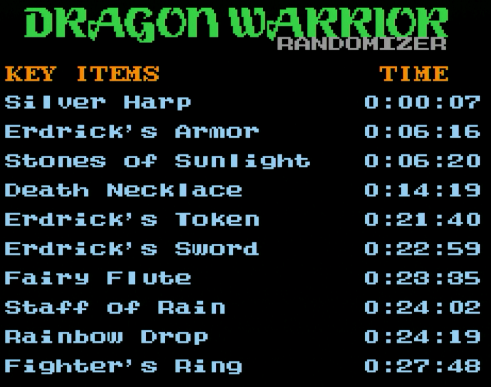
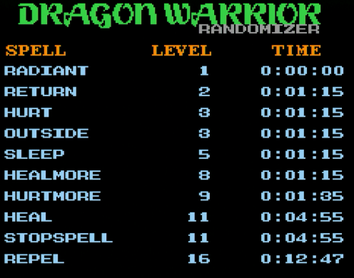
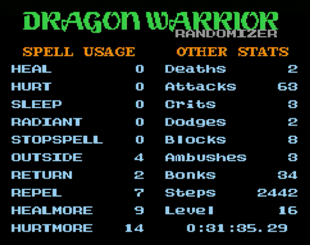

# Dragon Warrior Randomizer - dabbit edition #

This is an unofficial fork of [mcgrew's Dragon Warrior Randomizer](https://github.com/mcgrew/dwrandomizer),
built on its 3.0.4 code. It adds a few new options, a spoiler log and a bigger end-of-game stats
screen, and keeps everything else from the main randomizer exactly as it was. If you want the
official, tuned experience, use [dwrandomizer.com](https://dwrandomizer.com/release).

**Play it here: [sillydabbit.github.io/dwrandomizer](https://sillydabbit.github.io/dwrandomizer/)**, or
download the Windows app from the [latest release](https://github.com/sillydabbit/dwrandomizer/releases/latest).
The new options are mixed into the tabs where they fit best (Features, Shortcuts, Challenge,
Cosmetic). The title screen of every ROM it makes reads `DABBIT EDITION 1.0.0`.

For races, have everyone generate their seed on the same site - a ROM from this edition and one
from the main randomizer won't match once any of the new options is on. Compare checksums before
you start.

## New features ##

#### Progressive Equipment ####
*Challenge tab*

Weapons, armor and shields have to be bought in order: a shop will only sell you the next one up
from what you're wearing. If you try to skip ahead, the shopkeeper tells you which one you need
first. Every tier is guaranteed to be on sale somewhere, so the chain is never broken. With Random
Weapon Prices on, prices still rise tier by tier.

Erdrick's Sword and Erdrick's Armor follow the same rule - you need the Flame Sword and Magic
Armor first - and neither will ever be in the Tantegel Throne Room.

#### Oops All Treasure Guards ####
*Challenge tab*

Treasure Guards, turned all the way up: chests and search spots with items will have a mid-level
monster guarding them, not just the important ones. Step on the tile and you fight.
Beat a guard and it stays beaten; run away and you're put back on the tile you came from.

Never guarded: the chests in Tantegel's Throne Room (where you start), the Staff of Rain chest, and
any spot with nothing in it. The game's own encounter tiles (like the one at Hauksness) work as
they always have. Takes over from the regular Treasure Guards option when both are on.

Fights can now happen in towns, which the original game never does. Townspeople finish their
step before the fight starts, so they don't walk out of step afterwards.

#### Guaranteed Gold Grind ####
*Shortcuts tab*

Guarantees a gold chest inside Tantegel Castle, so the classic gold grind - fill your chest list
somewhere, die, and reopen the castle's gold chests as often as you like - is always available
early. It never depends on a chest in Charlock. With Random Chest Locations on, the gold chest can
be in another room of the castle instead of the treasury.

#### Permanent Radiant ####
*Features tab*

At least a 7x7 area is always lit in dungeons, like a permanent RADIANT. Using a torch won't dim
it. When spell learning is randomized, RADIANT is taken out of the spells you can learn (the same
way Permanent Repel handles REPEL).

#### Tablet Cave Torch ####
*Features tab*

At least a 3x3 area is always lit in Tablet Cave (Erdrick's Cave), and only there - other caves are
unaffected. With Stair Shuffle on, the free light stays in Tablet Cave rather than following you
into a connected dungeon. Permanent Torch and Permanent Radiant both override this option.

#### Spoiler Log ####
*Cosmetic tab*

Also downloads `DWRando.<seed>.<flags>.spoiler.txt` with the ROM: where every key item is, every
chest and search spot (and what guards it), the entrances, shops, hero stats, enemies and encounter
tiles. Handy for practice, testing, or settling "where was the harp?".

It's built so it can't be used to cheat a race: a seed with the spoiler log on is a **different
game** from the same seed with it off (different checksum), the title screen says **SPOILERS**,
and the option is part of the flags, so it shows up in shared links.

#### Expanded stats screen ####
*Always on*

After the credits, three new pages join the stats loop:

- **KEY ITEMS / TIME** - each key item you found and the play time you first picked it up, in the
  order you found them. Your route through the seed, at a glance.
- **SPELL / LEVEL / TIME** - each spell you learned, the level you learned it at, and when.
- **OTHER STATS** - the original stats plus **Steps** and the **Level** you finished at.

The Play Time on that page now shows every hundredth of a second; the original could only show 59
of the 100.

## Known Issues ##

These come from the main randomizer and are still present here. Fixes for each are written and
waiting to be added:

- **Rare unbeatable seeds:** occasionally Rimuldar can be placed where it can't be reached without a
  key you can't get.
- **Generation can hang** on some seeds, most often with Random Map off. If Randomize never
  finishes, pick another seed.
- **Repel in Dungeons is always on,** whether or not the option is ticked.
- **"searched" text glitch:** with Fast Text on, searching on a chest can print a cut-off line with
  a stray "4".
- **NPCs can walk out of step** after a regular Treasure Guards fight in a town (Oops All Treasure
  Guards has its own fix).

Also:

- **Dabbit edition ROMs and main-randomizer ROMs aren't interchangeable for races** (see above).
- **The Windows app is unsigned,** so Windows SmartScreen warns the first time you run it
  (More info, then Run anyway). There's no Linux or Mac build yet - use the web version.

## Credits ##

Please don't report dabbit edition problems to the main randomizer.

Built on the work of **mcgrew** and the Dragon Warrior Randomizer contributors. The "dabbit
edition" lettering uses **Annifont** by Annie de la Vega (freeware, non-commercial).
